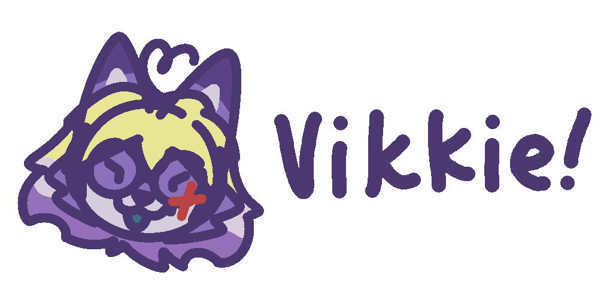
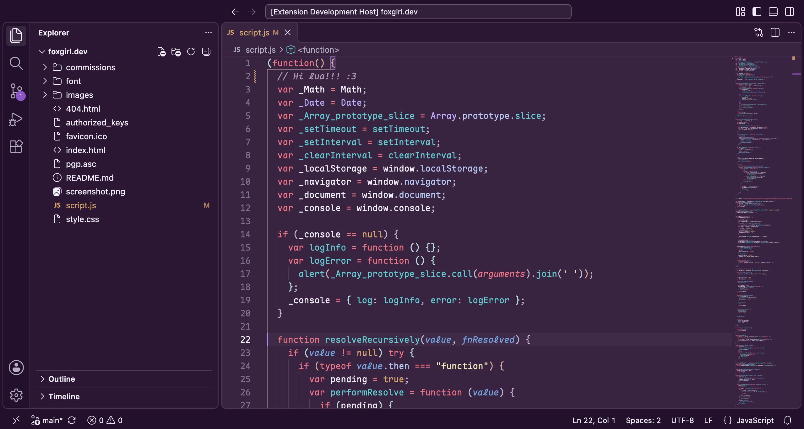
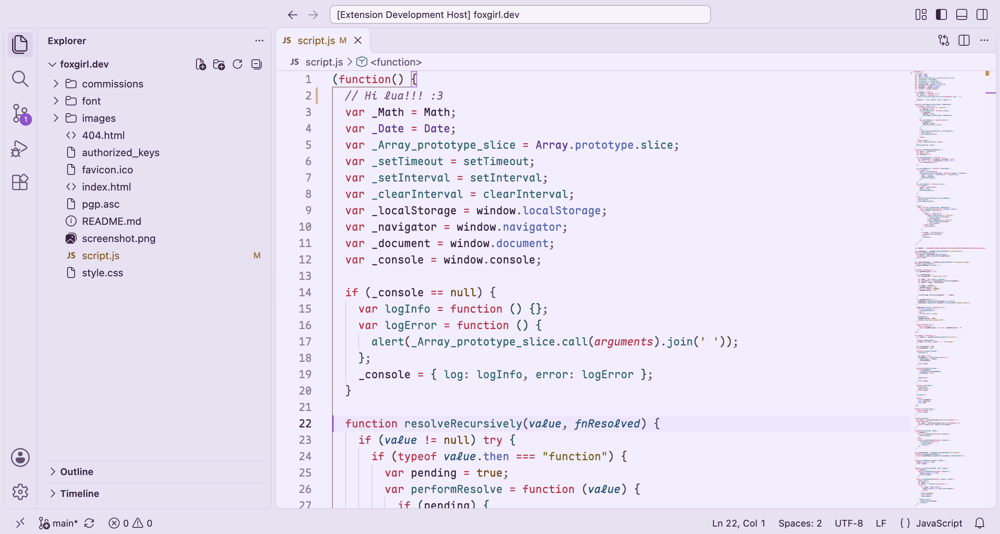

# Vikkie!!! Theme

A purple VSCode theme based on [luavixen](https://foxgirl.dev/)'s fursona [Vikkie](https://foxgirl.dev/vikkie/)!!!

Made for luavixen's Birthday.

Every color is built from Vikkie's reference sheet (the terminal's greens are the one exception, since the sheet has no green). It supports VS Code's modern UI (floating panels, connected tabs, frosted-glass menus) and semantic highlighting.

## Screenshots

## Color Summary

### Reference Sheet Palette

| Swatch      | Hex       | Used for                                              |
| ----------- | --------- | ----------------------------------------------------- |
| Fur White   | `#F4EEFF` | Dark text, Light editor background, neutral ramp      |
| Fur Purple  | `#916CDB` | Selections                                            |
| Hair Yellow | `#F1E8B2` | Dark strings, search highlights                       |
| Blush       | `#D9C0BA` | Bracket pairs                                         |
| Mauve       | `#C298C2` | Comments                                              |
| Violet      | `#9750D1` | The one UI accent: buttons, badges, focus, active tab |
| Ink Plum    | `#3B2243` | Dark editor background, Light text, neutral ramp      |
| Sock Purple | `#5B3095` | Light types                                           |
| Eye Teal    | `#22CED0` | Functions, success, added lines                       |
| Deep Teal   | `#0F656E` | Light functions                                       |

From the art: Sweater Blue `#66A5E2` / `#B0C8F3` (info, parameters, properties), Crosshair Red `#ED0C3D` (errors, deletions, keywords), Bell Gold `#E1A665` (warnings, modified files, numbers), Implant Mint `#7B9E9A` (bracket pairs).

All UI colors are built as OKLCH ramps from these swatches. Body text and every colored terminal color meet WCAG AA (4.5:1); control edges and the keyboard focus ring meet 3:1. Syntax colors are tuned for color-blind readers (checked in simulated protanopia, deuteranopia and tritanopia), and comments are italic so they don't rely on color alone.

### Dark

#### Background Colors

- Shell (Title Bar, Activity Bar, Status Bar): `#260F2D`
- Surface (Side Bar, Panel, Tabs): `#2E1635`
- Editor: `#3B2243`
- Widgets (Hover, Suggest, Menus): `#452D4E`
- Border: `#4C3556`
- Control Border (Inputs, Checkboxes): `#8A7A96`

#### Text Colors

- Main Text: `#F4EEFF`
- Secondary Text: `#B7ACC4`
- Muted Text (Line Numbers, Placeholders): `#81708E`

#### Accent Colors

- Accent (Buttons, Badges): `#9750D1`
- Accent Line (Active Tab, Cursor): `#B988E8`
- Accent Text & Focus Ring (Links, Matches, Keyboard Focus): `#D0ABF5`
- Selection: `#A76BDC5C` (with alpha)
- Search Highlight: `#F1E8B2`

#### Status Colors

- Success / Added: `#22CED0`
- Error / Deleted: `#FD7579`
- Warning / Modified: `#E1A665`
- Info: `#66A5E2`

#### Syntax Highlighting Colors

- Keyword, Operator, Regex & Escape: `#FD6C82`
- Function: `#22CED0`
- String: `#F1E8B2`
- Number & Constant: `#E1A665`
- Type & Class: `#BEACFF`
- Parameter: `#66A5E2` (italic)
- Property: `#B0C8F3`
- Comment: `#B995BE` (italic)
- Punctuation: `#BEB3CA`
- Bracket Pairs: `#A8DDD7` `#DEA99C` `#C0B4D6` (repeating)

#### Terminal Colors

- ANSI Black: `#1F0925`
- ANSI Red: `#FD7579`
- ANSI Green: `#63D99B`
- ANSI Yellow: `#E1A665`
- ANSI Blue: `#66A5E2`
- ANSI Magenta: `#BEACFF`
- ANSI Cyan: `#22CED0`
- ANSI White: `#DBD3E7`

### Light

#### Background Colors

- Shell & Surface (Title Bar, Activity Bar, Status Bar, Side Bar, Panel, Tabs): `#E8E1F3`
- Editor: `#F4EEFF`
- Widgets (Hover, Suggest, Menus): `#FBF9FF`
- Border: `#DBD3E7`
- Control Border (Inputs, Checkboxes): `#8B7B98`

#### Text Colors

- Main Text: `#3B2243`
- Secondary Text: `#634E6E`
- Muted Text (Line Numbers, Placeholders): `#90809C`

#### Accent Colors

- Accent (Buttons, Badges, Active Tab, Cursor): `#9750D1`
- Accent Text & Focus Ring (Links, Matches, Keyboard Focus): `#7B43AB`
- Selection: `#A76BDC47` (with alpha)
- Search Highlight: `#E1A665` / `#F1E8B2` (with alpha)

#### Status Colors

- Success / Added: `#067072`
- Error / Deleted: `#C30F32`
- Warning / Modified: `#905806`
- Info: `#1367AB`

#### Syntax Highlighting Colors

- Keyword, Operator, Regex & Escape: `#C71E44`
- Function: `#0F656E`
- String: `#7A6002`
- Number & Constant: `#744400`
- Type & Class: `#5B3095`
- Parameter: `#004F77` (italic)
- Property: `#5065B6`
- Comment: `#7B5D86` (italic)
- Punctuation: `#634E6E`
- Bracket Pairs: `#1E514D` `#663A30` `#554967` (repeating)

#### Terminal Colors

- ANSI Black: `#3B2243`
- ANSI Red: `#9F0526`
- ANSI Green: `#005A36`
- ANSI Yellow: `#714402`
- ANSI Blue: `#03508A`
- ANSI Magenta: `#6E2CA0`
- ANSI Cyan: `#055758`
- ANSI White: `#BDB2CA`

## Development

The theme files in `themes/` are generated. Edit `scripts/gen.mjs`, not the JSON.

- `npm run build` regenerates both themes
- `npm run audit` checks contrast, focus rings, the one-accent rule, bracket colors and color-blind distinctness

`scripts/syntax-search.mjs` and `scripts/bracket-search.mjs` are the searches that picked the syntax and bracket colors. The `scripts/` folder isn't included in the published extension.

## License

MIT
